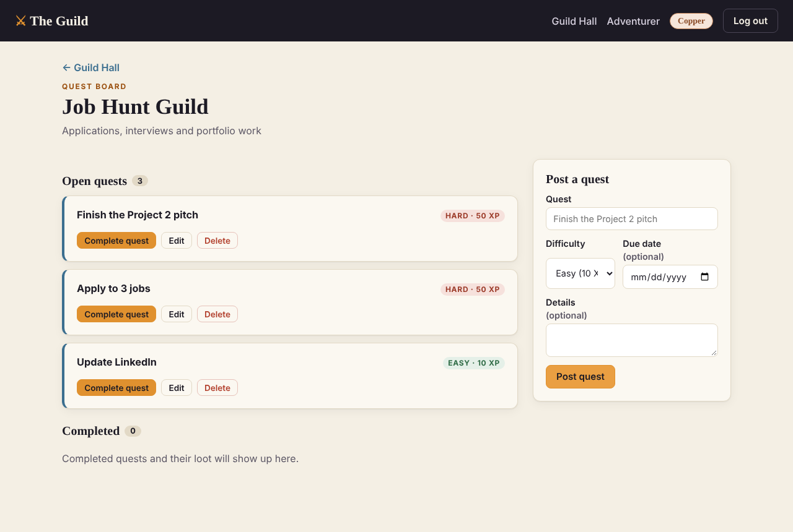
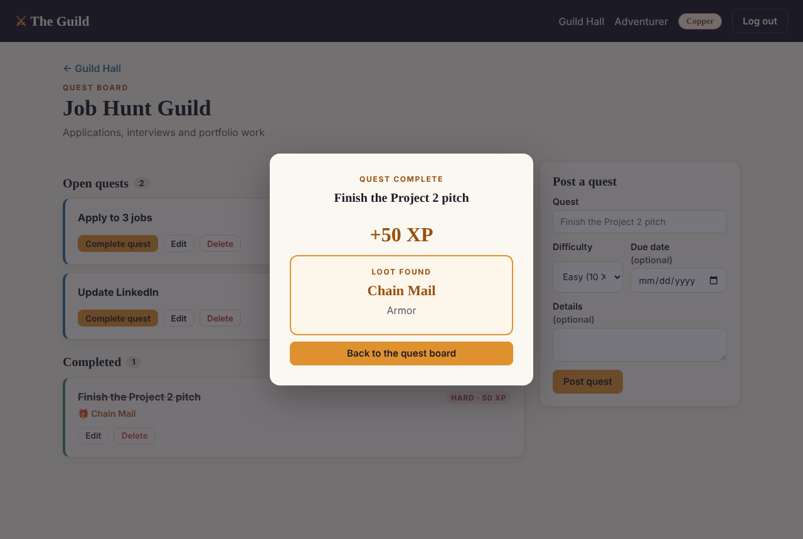
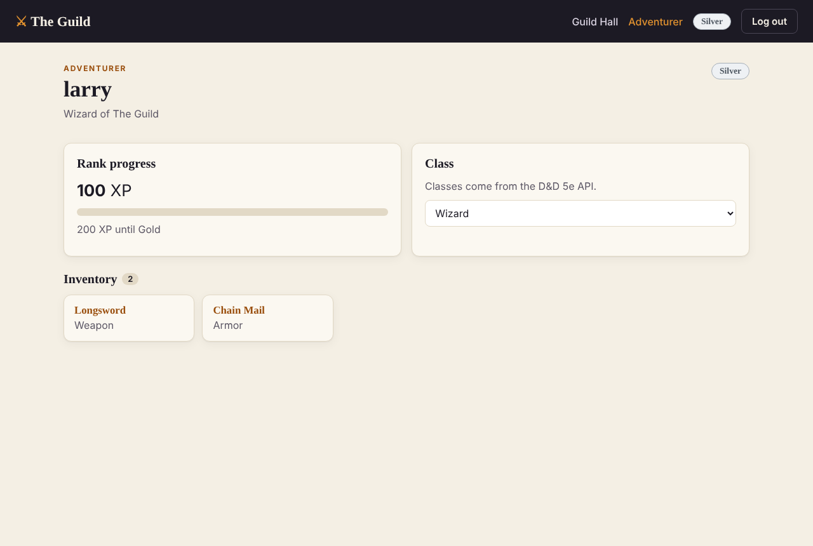

# ⚔ The Guild

A productivity app styled as a fantasy Adventurers' Guild. Create **guilds** around your goals, post tasks as **quests**, and earn XP to rank up from **Copper → Silver → Gold → Mythril**. Every completed quest grants a random item from the free [D&D 5e API](https://www.dnd5eapi.co), saved to your inventory.



## Features

- **Accounts:** register and log in (bcrypt-hashed passwords, JWT tokens).
- **Guilds (full CRUD):** create, view, rename and disband guilds.
- **Quests (full CRUD):** post, edit, complete and delete quests with a difficulty (Easy 10 XP, Medium 25 XP, Hard 50 XP) and an optional due date. Overdue quests are highlighted.
- **XP and ranks:** completing a quest adds XP on the server; a rank-up is announced in the reward screen.
- **D&D 5e API rewards:** each completed quest fetches a random equipment item; the full API response is stored in the `rewards` table with SQLAlchemy.
- **Adventurer profile:** choose a D&D class (loaded from the API), see rank progress and your inventory.
- **Error handling:** readable messages for validation errors, 401/404/409s and API outages. If the D&D API is down, the quest and XP are still saved and the reward can be claimed later.

| Reward screen | Adventurer profile |
| --- | --- |
|  |  |

## Tech stack

| Layer | Tools |
| --- | --- |
| Backend | Python, FastAPI, SQLAlchemy 2.0, Pydantic, bcrypt, PyJWT, httpx |
| Database | SQLite (local); any SQLAlchemy database via `DATABASE_URL` |
| Frontend | React 18, Vite, React Router, `useState` / `useEffect` / Context, plain CSS |
| Testing | pytest + FastAPI `TestClient` (D&D API mocked) |

## Data model

| Model | Key fields | Relationships |
| --- | --- | --- |
| `User` | username, email, password_hash, character_class, xp | owns many Guilds; has many Quests and Rewards; `rank` is computed from XP |
| `Guild` | name, description, owner_id | belongs to a User; has many Quests (deleted with the guild) |
| `Quest` | guild_id, user_id, title, description, difficulty, due_date, status, completed_at | belongs to a Guild and a User; has at most one Reward |
| `Reward` | user_id, quest_id, item_index, item_name, item_category, api_response (JSON) | belongs to a User; keeps its item if the quest is deleted |

## Getting started

You need **Python 3.11+** and **Node.js 18+**. Run the backend and frontend in two terminals.

### 1. Backend (FastAPI)

```bash
cd backend
python -m venv .venv
source .venv/bin/activate        # Windows: .venv\Scripts\activate
pip install -r requirements.txt
cp .env.example .env             # optional: edit SECRET_KEY etc.
uvicorn app.main:app --reload
```

The API runs at http://localhost:8000. Interactive docs: http://localhost:8000/docs. The SQLite database (`guild.db`) is created automatically on first run.

### 2. Frontend (React + Vite)

```bash
cd frontend
npm install
npm run dev
```

Open http://localhost:5173. In development, Vite forwards `/api` requests to the backend on port 8000.

### 3. Run the tests

```bash
cd backend
python -m pytest
```

## API routes

All routes except register, login and health need an `Authorization: Bearer <token>` header.

| Method | Route | Description |
| --- | --- | --- |
| POST | `/api/auth/register` | Create an account; returns a token and the user |
| POST | `/api/auth/login` | Log in; returns a token and the user |
| GET | `/api/users/me` | Current adventurer (XP, rank, next rank) |
| PATCH | `/api/users/me` | Set character class (validated against the D&D API) |
| GET | `/api/classes` | D&D classes from the API (503 if unavailable) |
| GET | `/api/rewards` | Inventory, newest first |
| GET / POST | `/api/guilds` | List / create guilds |
| GET / PATCH / DELETE | `/api/guilds/{id}` | Read / update / disband a guild |
| GET / POST | `/api/guilds/{id}/quests` | List (`?status=open\|completed`) / create quests |
| GET / PATCH / DELETE | `/api/quests/{id}` | Read / update / delete a quest |
| POST | `/api/quests/{id}/complete` | Complete: adds XP, checks rank-up, fetches and saves a reward |
| POST | `/api/quests/{id}/reward` | Retry a reward that failed because the API was down |
| GET | `/api/health` | Health check |

## Deploying to Vercel

The repo deploys as **one Vercel project**: Vite builds the React app into `frontend/dist`, and `api/index.py` runs the FastAPI backend as a serverless function. `vercel.json` sends every `/api/*` request to the function and every other path to the React app, so both share one domain and no CORS setup is needed.

1. In Vercel, **Add New → Project** and import this GitHub repo. Leave the root directory as `./`; the build settings come from `vercel.json`.
2. Under the project's **Storage** tab, add a **Neon** Postgres database and connect it to the project. This sets `DATABASE_URL` for you. Tables are created on the first request.
3. Under **Settings → Environment Variables**, add `SECRET_KEY` (generate one with `python -c "import secrets; print(secrets.token_hex(32))"`).
4. Deploy. Every push to `main` redeploys; pull requests get preview URLs.

Without a database the API falls back to SQLite in `/tmp`, which Vercel wipes regularly, so accounts and quests won't last.

## Configuration

Set in `backend/.env` (see `.env.example`):

| Variable | Default | Purpose |
| --- | --- | --- |
| `DATABASE_URL` | `sqlite:///./guild.db` | SQLAlchemy database URL |
| `SECRET_KEY` | dev-only value | Signs login tokens. **Change it before deploying.** |
| `TOKEN_EXPIRE_MINUTES` | `1440` | Login session length |
| `DND_API_BASE` | `https://www.dnd5eapi.co/api/2014` | D&D 5e API base URL |
| `DND_API_TIMEOUT` | `5` | Seconds before an API call gives up |
| `CORS_ORIGINS` | `http://localhost:5173` | Frontend origins allowed to call the API |

For a deployed frontend, set `VITE_API_URL` to the backend's URL when building.

## Project structure

```
backend/
  app/
    main.py          FastAPI app, CORS, error handlers
    config.py        Settings from environment variables
    database.py      Engine, session, Base
    models.py        User, Guild, Quest, Reward
    schemas.py       Pydantic request/response models
    auth.py          Password hashing, JWT, get_current_user
    game.py          XP values and rank thresholds
    dnd_api.py       D&D 5e API client (timeouts, caching, errors)
    routers/         auth, users, guilds, quests
  tests/             pytest suite
frontend/
  src/
    api.js           All backend calls + error handling
    context/         AuthContext (login state)
    pages/           AuthPage, GuildHall, GuildPage, AdventurerProfile, NotFound
    components/      NavBar, GuildCard, GuildForm, QuestCard, QuestForm, RewardModal, …
```

## Roadmap (post-MVP)

- **Shared guilds:** a `GuildMembership` table so users can join each other's guilds and work toward shared goals.
- Guild leaderboards.
- Monster "bounties" for overdue quests, using the API's `/monsters` endpoint.

## Credits

Game content comes from the D&D 5e System Reference Document via [dnd5eapi.co](https://www.dnd5eapi.co).
